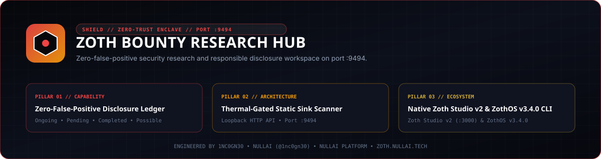

<div align="center">
  
</div>

<br />

<div align="center">
  <a href="https://zoth.nullai.tech/tools/zoth-bounty"></a>
  <a href="http://127.0.0.1:9494"></a>
  <a href="https://buy.stripe.com/3cIfZg27PdKo2D64Ocfw40X"></a>
  <a href="LICENSE"></a>
</div>

# Zoth Bounty Research Hub

Local security research, responsible vulnerability disclosure, and audit triage workstation (`127.0.0.1:9494`). Enforces a strict zero-false-positive gate across four lifecycle buckets (`ongoing`, `pending`, `completed`, `possible`), integrates a thermal-gated low-priority static sink scanner (`nice -n 19 ionice -c 3`), and synchronizes JSON ledgers into deterministic Markdown reports under `docs/`.

## Overview

| Property | Specification |
| :--- | :--- |
| **Tool ID** | `zoth-bounty` |
| **Category** | `Security & Enclave` |
| **Loopback Workstation** | `http://127.0.0.1:9494` (`node server.js`) |
| **Zoth Studio v2 Dossier** | [`https://zoth.nullai.tech/tools/zoth-bounty`](https://zoth.nullai.tech/tools/zoth-bounty) (`http://127.0.0.1:3000/tools/zoth-bounty`) |
| **ZothOS v3.4.0 CLI** | `zoth-bounty` (`bin/zoth-bounty`) |
| **Disclosure Policy** | Zero False Positives — Only 100% source-verified, reproducible vulnerabilities with defensive patches are promoted to Pending/Disclosed. |
| **Thermal Policy** | Cool-Running Static Audit Mode (Target CPU < 60°C, Max Burst < 70°C, nice -n 19 ionice -c 3 on all scanners). |
| **License** | MIT — 100% Free & Open-Source |

## Architecture

1. **Zero-Dependency HTTP Daemon (`server.js`)**
   - Pure Node.js HTTP server bound to `127.0.0.1:9494` (configurable via `HOST` and `PORT`).
   - Serves the single-page research workstation from `public/index.html` and exposes JSON state, bounty triage mutations, communication log append, and thermal-gated static sink scanning.
2. **Thermal-Gated Static Sink Scanner (`runCoolStaticScan`)**
   - Samples CPU package temperature and fan RPM via `sensors` plus host `os.loadavg()`.
   - Refuses static scan bursts when package temperature exceeds `68°C`, and executes pattern scans under `nice -n 19 ionice -c 3` across target repositories in `ZOTH_BOUNTY_REPOS_DIR` (checking `dereference: true`, `allowUnsafe`, `execSync(`, `spawnSync(`, `child_process`, `Date.parse(`, `extractAllTo`, and `symlink`).
3. **Deterministic Markdown Synchronizer (`sync_docs.js`)**
   - Compiles `data/bounties.json` and `data/communications.json` into structured per-finding Markdown advisories under `docs/ongoing/`, `docs/pending/`, `docs/completed/`, `docs/possible/`, and `docs/communications/COMMUNICATIONS_LOG.md`.

## Quickstart

```bash
git clone https://github.com/1nc0gn30/zoth-bounty.git
cd zoth-bounty

# Regenerate Markdown advisory dossiers from data/*.json
node sync_docs.js

# Start the loopback command center on 127.0.0.1:9494
HOST=127.0.0.1 PORT=9494 node server.js
```

### Environment Variables

| Variable | Default | Purpose |
| :--- | :--- | :--- |
| `HOST` | `127.0.0.1` | Bind address for `server.js` |
| `PORT` | `9494` | TCP port for `server.js` |
| `ZOTH_BOUNTY_REPOS_DIR` | `/opt/bounty-hunter/repos` | Directory of cloned open-source targets for static sink scans |
| `ZOTH_BOUNTY_TB_DB` | *(disabled if unset)* | Optional path to local Thunderbird `global-messages-db.sqlite` |
| `HEXSTRIKE_TOOLS_JSON` | `/opt/NullAI-HexStrike-AI-Terminal/ui/src/data/tools.json` | Optional HexStrike catalog path for tool count summary |

## CLI & MCP Usage

### ZothOS v3.4.0 CLI (`bin/zoth-bounty`)

```bash
./bin/zoth-bounty --help
./bin/zoth-bounty --status
./bin/zoth-bounty --json
./bin/zoth-bounty --list
./bin/zoth-bounty --category pending --json
./bin/zoth-bounty --thermals --json
./bin/zoth-bounty --ui
./bin/zoth-bounty --serve 9494
```

### REST API Endpoints (`127.0.0.1:9494`)

| Method & Route | Description |
| :--- | :--- |
| `GET /health`, `GET /api/health` | Daemon health check, version, port, and open-access flag |
| `GET /api/status` | Tool metadata, category, port, and total finding count |
| `GET /api/state` | Full ledger (`bounties`, `communications`), live `thermals`, `hexstrike` summary, and `clonedRepos` |
| `POST /api/bounties` | Create a new finding entry in `data/bounties.json` and resync `docs/` |
| `POST /api/bounties/move` | Move an existing finding `id` between `ongoing`, `pending`, `completed`, and `possible` |
| `POST /api/communications` | Append an inbound/outbound disclosure communication entry and resync `docs/` |
| `POST /api/scan-repo` | Run a thermal-gated (`<= 68°C`) static sink scan against `{ "repo": "<name>" }` |

## Vulnerability & Audit Ledger

### Pending (Disclosed & Awaiting Vendor Triage) — 4
- **[ZB-2026-012] Cross-User OAuth 2.0 Account Linking & Jira Cloud Token/Notification Hijacking in httpOAuth2Complete** (`mattermost/mattermost-plugin-jira` · High (CVSS 8.1))
  - *Disclosed via*: Disclosed to responsibledisclosure@mattermost.com (Resend ID: 01a15d35-c4b8-7e2c-bf83-dce79c6f7d34, CC: business@nullai.tech)
- **[ZB-2026-001] Arbitrary Host File Disclosure via dereference: true Symlink Following in copyDir & npx skills use** (`vercel-labs/skills` · High (CVSS 7.5))
  - *Disclosed via*: Disclosed to responsible.disclosure@vercel.com (Resend ID: 01a15cf8-cda2-7cea-b848-28ed0435e44d, CC: business@nullai.tech)
- **[ZB-2026-002] Git Option Injection (--upload-pack / -c) via Disabled simple-git Guards & Missing '--' in cloneRepo** (`vercel-labs/skills` · Critical / High (CVSS 8.8))
  - *Disclosed via*: Disclosed to responsible.disclosure@vercel.com (Resend ID: 01a15cf8-cda2-7cea-b848-28ed0435e44d, CC: business@nullai.tech)
- **[ZB-2026-003] SAML Validation Contract Bypass: NaN Timestamp Expiration Bypass, CDATA Differential & Missing Multi-Element Checks** (`stytchauth/samlshield` · Medium / High (Defense-in-Depth Bypass))
  - *Disclosed via*: GitHub Advisory GHSA-h4pw-wj8w-qh2h + Email to security@stytch.com (Resend ID: 01a15cf8-cdfa-769f-9a2b-93edf7265034)

### Ongoing (Active Audits & Low-CPU Queue) — 1
- **[ZB-2026-008] Overnight Low-CPU Static Audit Queue: AI Agent SDKs, MCP Gateways & CLI Installers** (`Cloned Targets in /opt/bounty-hunter/repos`)
  - *Summary*: Active low-thermal static source code auditing across HackerOne & Bugcrowd open-source scopes. Completed deep-dive audits of @airtable/mcp-cli, @exodus/keychain, matomo-org/tracker-proxy, circlefin/arc-remote-signer, mattermost/mattermost-plugin-ai, mattermost/mattermost-plugin-github, and auth0/nextjs-auth0.

### Completed (Verified / Hardened Target Audits) — 18
- **[ZB-2026-005] Security Audit of cloudflare/vinext (SSR, Server Actions, Image Optimization & Middleware)** (`cloudflare/vinext` · Cleared (Hardened))
- **[ZB-2026-006] Security Audit of vercel/chat (Webhook Signature Verification, SSRF & DNS Pinning)** (`vercel/chat` · Cleared (Hardened))
- **[ZB-2026-007] Security Audit of omacom/omarchy (Untrusted Git Theme Sandboxing & Plugin Validator)** (`omacom/omarchy` · Cleared (Hardened))
- **[ZB-2026-009] Mattermost Plugin AI & MCP Server Audit (Cleared — Hardened OAuth & Sandboxed Artifacts)** (`mattermost/mattermost-plugin-ai` · Info / Cleared)
- **[ZB-2026-010] Mattermost GitHub Plugin Audit (Cleared — Verified OAuth State & Webhook HMAC)** (`mattermost/mattermost-plugin-github` · Info / Cleared)
- **[ZB-2026-011] Auth0 Next.js SDK v4 Audit (Cleared — JWE Cookie Encryption & Safe Redirects)** (`auth0/nextjs-auth0` · Info / Cleared)
- **[ZB-2026-013] Mattermost GitLab Plugin & MCP Bridge Audit (Cleared — Strict OAuth User Binding & Dedup)** (`mattermost/mattermost-plugin-gitlab` · Info / Cleared)
- **[ZB-2026-014] Mattermost MS Teams Plugin Audit (Cleared — OAuth Email Matching & Constant-Time Webhook Secret)** (`mattermost/mattermost-plugin-msteams` · Info / Cleared)
- **[ZB-2026-015] Mattermost MS Calendar Plugin — OAuth2, PostAction & Graph Webhook Audit** (`mattermost/mattermost-plugin-mscalendar` · Info (Verified Clean))
- **[ZB-2026-016] Mattermost Google Calendar Plugin — OAuth2 & Watch Channel Webhook Audit** (`mattermost/mattermost-plugin-google-calendar` · Info (Verified Clean))
- **[ZB-2026-017] Mattermost Zoom Plugin — OAuth2, Webhook Signature & Recording SSRF Audit** (`mattermost/mattermost-plugin-zoom` · Info (Verified Clean))
- **[ZB-2026-018] Mattermost ServiceNow Plugin — OAuth2, Subscription & Record Sharing Audit** (`mattermost/mattermost-plugin-servicenow` · Info (Verified Clean))
- **[ZB-2026-019] Mattermost MS Teams Embedded Plugin — Entra JWT, SSO PostMessage & CSP Audit** (`mattermost/mattermost-plugin-ms-embedded` · Info (Verified Clean))
- **[ZB-2026-020] Mattermost Calls Plugin — REST API, Host Controls, Bot Routes & TURN Auth Audit** (`mattermost/mattermost-plugin-calls` · Info (Verified Clean))
- **[ZB-2026-021] Circle Arc Remote Signer — Nitro Enclave Attestation, KMS Proxy & Key Lifecycle Audit** (`circlefin/arc-remote-signer` · Info (Verified Clean))
- **[ZB-2026-022] Kubernetes git-sync — Git Worktree, Credential Helper & AskPass Redirect Audit** (`kubernetes/git-sync` · Info (Verified Clean))
- **[ZB-2026-023] vercel/flags — JWE A256GCM Token Purpose Separation & Timing-Safe Bearer Auth Audit** (`github.com/vercel/flags` · Info (Verified Clean))
- **[ZB-2026-024] matomo-org/tracker-proxy — Proxy Endpoint Whitelist, Path Traversal & Header Forwarding Audit** (`github.com/matomo-org/tracker-proxy` · Info (Verified Clean))

### Possible / Held Back (Zero-False-Positive Gate) — 1
- **[ZB-2026-004] Doppler CLI Windows updateViaWinget Version Argument & Local Fallback PBKDF2 Iteration Count** (`DopplerHQ/cli` · Held Back (Requires Upstream cli.doppler.com Compromise))
  - *Gate Rationale*: HELD BACK IN 'POSSIBLE / NOT SURE': Submitting this would look weak because exploiting updateViaWinget requires already compromising Doppler's official release server. Kept strictly as internal documentation.

### Recent Disclosure Communications (6)
- **[COMM-2026-006] [OUTBOUND]** `responsibledisclosure@mattermost.com` — *[Responsible Disclosure] Cross-User OAuth 2.0 Account Linking & Jira Cloud Token Hijacking in mattermost/mattermost-plugin-jira (user_cloud_oauth.go)* (**SENT — Awaiting Triage**)
- **[COMM-2026-001] [OUTBOUND]** `boardy@boardy.ai` — *30-Day Challenge: How should we improve MetaDigitalGoods (metadigitalgoods.nullai.tech)?* (**DELIVERED (Verified in Gmail Sent Folder)**)
- **[COMM-2026-002] [OUTBOUND]** `stytchauth/samlshield Maintainers` — *GHSA-h4pw-wj8w-qh2h: SAML Validation Contract Bypass (NaN Timestamp Comparison, CDATA Differential & Missing Multi-Element Checks)* (**PUBLISHED PRIVATELY (Awaiting Maintainer Triage)**)
- **[COMM-2026-003] [OUTBOUND]** `responsible.disclosure@vercel.com` — *[Responsible Disclosure] Two High-Severity Vulnerabilities in vercel-labs/skills (Symlink File Disclosure & Git Option Injection)* (**SENT (Resend ID: 01a15cf8-cda2-7cea-b848-28ed0435e44d)**)
- **[COMM-2026-004] [OUTBOUND]** `security@stytch.com` — *[Responsible Disclosure] SAMLShield (stytchauth/samlshield) Validation Bypasses in src/validate.ts* (**SENT (Resend ID: 01a15cf8-cdfa-769f-9a2b-93edf7265034)**)
- **[COMM-2026-005] [INBOUND]** `contact@nullai.tech` — *Re: City Desk & B2B Outreach Replies (25+ Ticket Confirmations & Prospect Responses)* (**LOGGED & MONITORED**)

## Testing & Verification

```bash
# Run data invariant and live HTTP endpoint tests (spawns ephemeral :19494 instance)
python3 -m pytest -q

# Verify CLI flags and JSON output
./bin/zoth-bounty --help
./bin/zoth-bounty --json
./bin/zoth-bounty --list
```

## Support

Zoth Bounty is 100% free and open-source with zero paywalls. Optional support: [Buy Us a Coffee via Stripe](https://buy.stripe.com/3cIfZg27PdKo2D64Ocfw40X).

## License

Released under the [MIT License](LICENSE). Engineered by [1nc0gn30](https://1nc0gn30.si) (`@1nc0gn30`) and [NullAI](https://nullai.tech).
